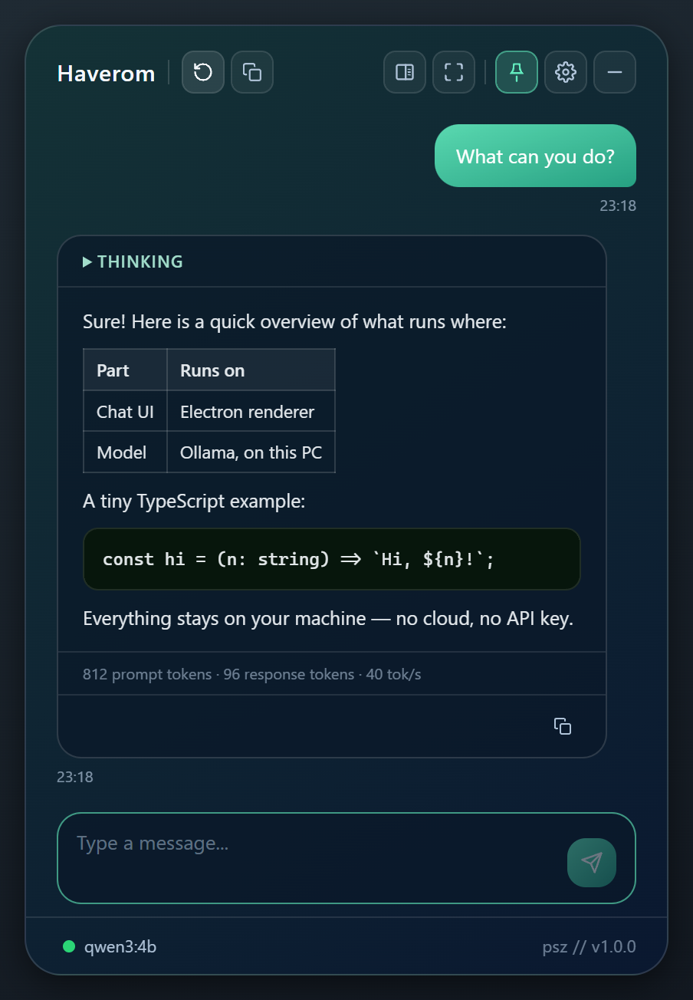
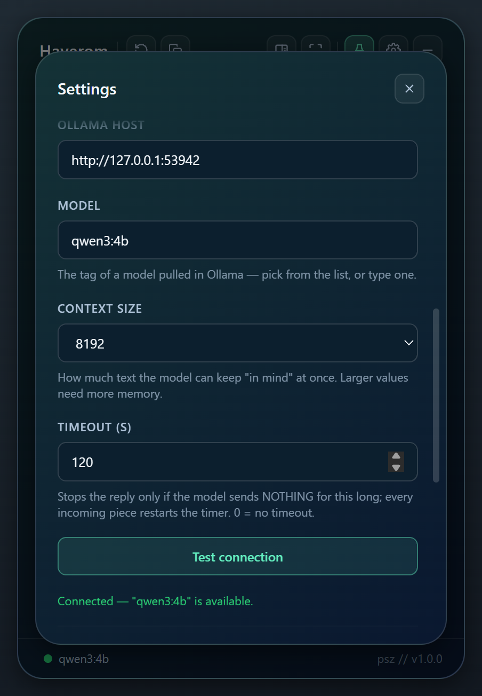
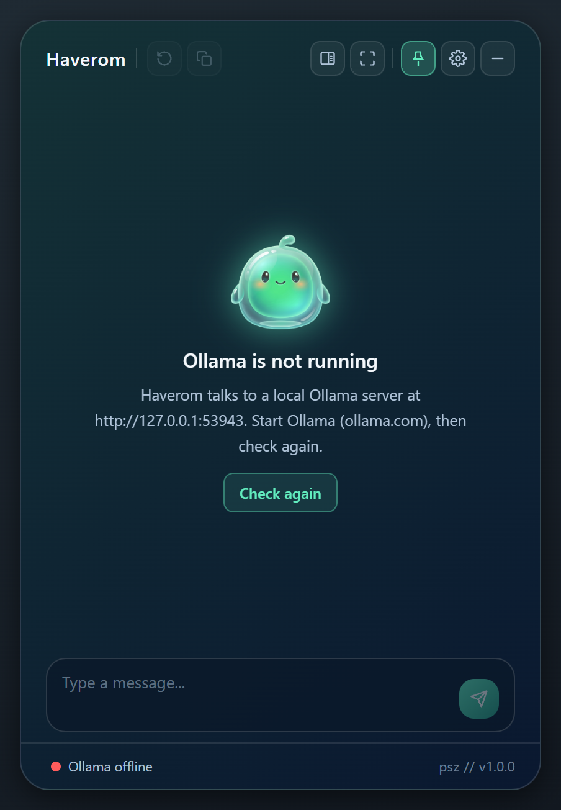
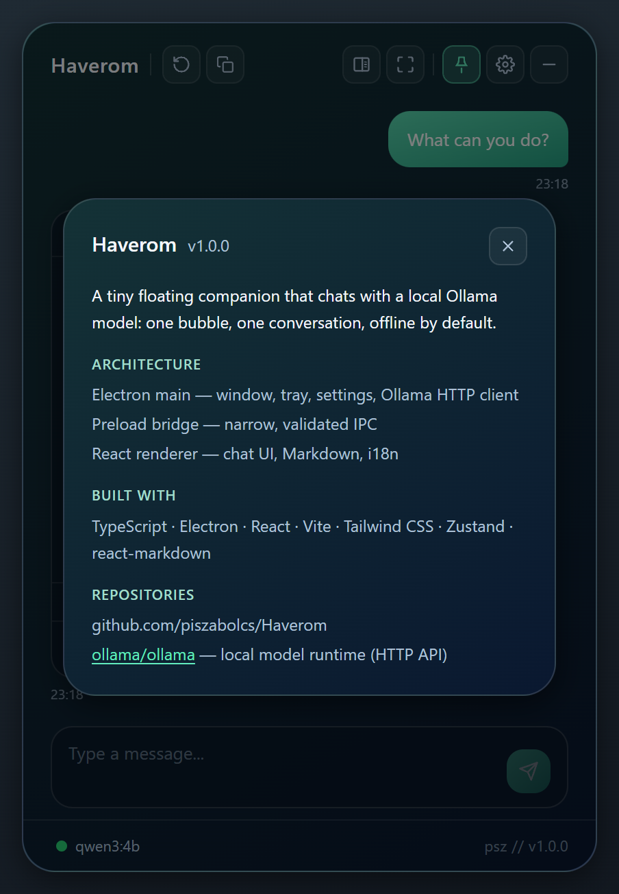
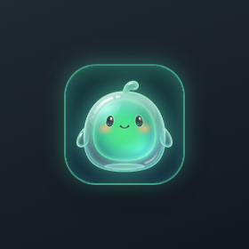
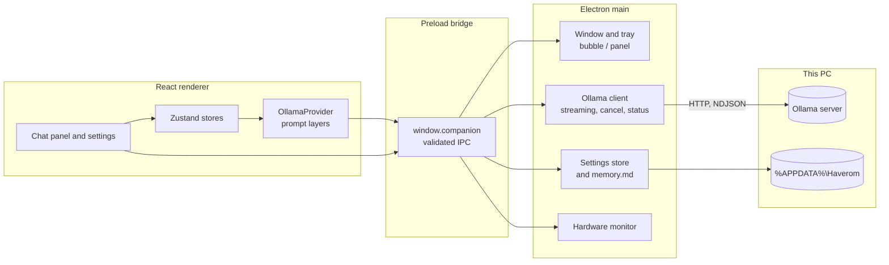

<div align="center">


# Haverom

**A floating desktop bubble that chats with your local Ollama model, offline by default**


[Features](#features) · [Screenshots](#screenshots) · [Architecture](#architecture) · [Installation](#installation)

</div>

<p align="center">
  
</p>

## The problem

Asking a local model a quick question usually means opening a terminal or a full chat application with
conversation lists, document retrieval and tool settings. For a short question that is too much, and
browser-based front ends add a web server and a tab to keep open. When the model does not answer, the user
often cannot tell whether Ollama is not running, the model is not pulled, or the request is still loading.

## The solution

Haverom sits on the desktop as a small bubble. A click opens one chat panel that talks only to a local
[Ollama](https://ollama.com) server: no cloud, no API key, no account. The footer shows the real Ollama state,
replies stream in with their token statistics, and a reply can be stopped at any time. It is the deliberately
small sibling of [Vellum](https://github.com/piszabolcs/vellum), the full desktop assistant with multiple
conversations, retrieval and tools.

## Features

- **Streaming replies.** The model's thinking appears in a collapsible block, followed by a token line (prompt and response tokens, tok/s).
- **Stop at any time.** The text received so far is kept and marked *Stopped*; an idle timeout (default 120 s) ends a request when the model sends nothing.
- **Real Ollama status.** A footer dot shows model ready, model not pulled or Ollama unreachable, with a *Check again* empty state and a *Test connection* that needs the exact model tag.
- **Model picker and context fallback.** The list comes from the models pulled in Ollama; if a large context runs out of memory, the request is retried with the next smaller context size.
- **Custom instructions.** Free text sent with every message, stored in `memory.md`.
- **One conversation, kept across restarts.** Copy a single reply or the whole conversation as Markdown.
- **Flexible panel.** Compact box, half screen or full work area, always-on-top pin, bubble in the bottom-left or bottom-right corner, tray icon.
- **English and Hungarian UI.** Includes error messages and the tray menu, plus large text, high contrast and an optional VRAM/RAM monitor (NVIDIA via `nvidia-smi`, off by default).

## Screenshots

<table>
  <tr>
    <td align="center" width="50%"><br/><sub>Settings with a passing connection test</sub></td>
    <td align="center" width="50%"><br/><sub>Empty state when Ollama is not running</sub></td>
  </tr>
  <tr>
    <td align="center" width="50%"><br/><sub>About card opened from the footer signature</sub></td>
    <td align="center" width="50%"><br/><sub>The collapsed bubble</sub></td>
  </tr>
</table>

The screenshots are generated off-screen by the end-to-end test against a fake Ollama server.

## Architecture



The renderer runs with `contextIsolation`, `sandbox` and no Node integration, so it can only use the narrow
`window.companion` API from the preload script. The main process owns the window, the tray, the settings file
and the HTTP client that streams NDJSON from Ollama. `electron/shared.ts` holds the settings schema, defaults,
IPC channel names and error codes; the main process reports error codes and the renderer translates them.

## Tech stack

| Layer | Technology |
|---|---|
| Desktop shell | Electron 44, esbuild for the main and preload bundles |
| UI | React 18, Vite 5, Tailwind CSS 3, Zustand, react-markdown with GFM |
| Language | TypeScript 5 |
| Model runtime | Ollama HTTP API on localhost |
| Tests | Vitest (unit), Playwright against a fake Ollama server (end-to-end) |
| Icons | Python and Pillow script in `tools/make_icons.py` |

## Installation

Prerequisites: Windows 10 or 11, [Node.js](https://nodejs.org) 22.12 or newer, and
[Ollama](https://ollama.com/download) running locally with at least one model.

1. Pull the default model (any pulled model can be chosen later in Settings):
   ```bash
   ollama pull qwen3:4b
   ```
2. Clone the repository and install the dependencies:
   ```bash
   git clone https://github.com/piszabolcs/haverom.git
   cd haverom
   npm install
   ```
3. Build and start the app (Electron downloads its runtime on first use; `npx install-electron` fetches it ahead of time):
   ```bash
   npm start
   ```

For development: `npm run dev` (Vite with hot reload plus Electron), `npm test` (Vitest), `npm run typecheck`,
`npm run e2e` (off-screen end-to-end smoke test) and `npm run screenshots` (the same run, refreshing the images in
`docs/screenshots/`).

## Usage

1. Click the bubble to open the panel. The footer dot is green when the model is ready, amber when it is not
   pulled and red when Ollama cannot be reached.
2. Type a question and press Enter; stop a reply with the stop button if needed.
3. Open Settings to change the Ollama host, model, context size, timeout, language or custom instructions,
   and use *Test connection* to check them.

Data stays in `%APPDATA%\Haverom`: `settings.json` (written atomically; a file that is not valid JSON is kept as
`settings.json.bak`), `memory.md` (custom instructions, max. 1 MB) and `Local Storage\` (the conversation).
Nothing is encrypted, since it is a local single-user app; delete the folder to reset Haverom.

Security notes: the only network peer is the configured Ollama host, called from the main process; the page
itself cannot make network requests (`connect-src 'self'`). Images in a model reply are shown as links and never
loaded, so a reply cannot leak conversation content through an image URL. Every IPC handler checks the sender and
validates its arguments, links open in the default browser (`http(s)` only), and *Start with Windows* is only
offered in a packaged build.

## Project structure

```text
haverom/
├── electron/      # main process: window, tray, settings, Ollama client, IPC validation, preload
├── src/           # React renderer
│   ├── components/  # chat view, bubble, settings, signature
│   ├── providers/   # Ollama provider and prompt layers
│   ├── store/       # Zustand stores for chat, settings and status
│   ├── i18n/        # English and Hungarian strings
│   └── utils/       # history, persistence, transcript, formatting
├── e2e/           # Playwright smoke test with an off-screen window hook
├── public/        # app icon, tray icon and mascot
├── tools/         # icon generator (Python, Pillow)
└── docs/          # logo and README screenshots
```

## Roadmap

- [ ] Packaged Windows installer, which also enables the *Start with Windows* option
- [ ] Hardware monitor for non-NVIDIA GPUs
- [ ] More UI languages beyond English and Hungarian

## License

MIT, see [LICENSE](LICENSE). Ollama and the models you run with it are separate software with their own licenses.

---

<div align="center">
<sub>Built by Szabolcs Pintér · <a href="https://github.com/piszabolcs">GitHub</a> · <a href="https://www.linkedin.com/in/piszabolcs">LinkedIn</a></sub>
</div>
